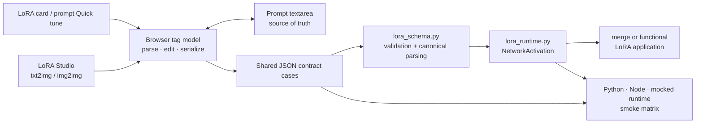
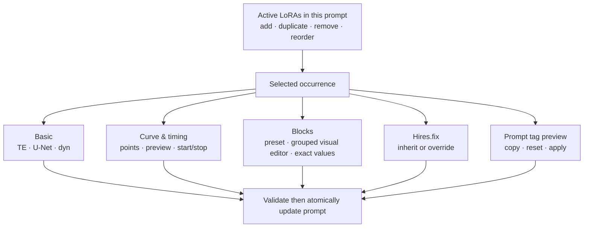

# LoRA Studio — architecture and implementation map

## Status and purpose

The next implementation sequence and acceptance gates are tracked in
[LORA_EVOLUTION_PLAN.md](LORA_EVOLUTION_PLAN.md). Its first increment adds a
shared preset picker; runtime plugin modules and UI-only generation snapshots
remain planned, not implemented.

This document is the implementation contract for a native LoRA Studio.  It is
not a separate WebUI extension and it does not replace the ordinary LoRA-card
workflow.  It defines one LoRA model, two user interfaces, clear ownership of
state, and a test-first path for future controls.

Already implemented:

- cached LoRA payloads are separated from per-prompt `NetworkActivation` state;
- scalar/curve weights, timing, Hires.fix values, dynamic rank, block weights
  and immutable elemental module overrides (`lbwe`) are implemented in
  `lora_advanced.py`;
- the card gear is a compact editor for the prompt tag.
- `LoraActivationSpec`, the profile registry and a typed preset schema now form
  a torch-free schema boundary in `lora_schema.py` / `lora_presets.py`;
- `test/lora_tag_contract.json` is checked by both Python and the browser-side
  `loraStudioModel.js` without loading a model.
- the existing card gear uses that browser model and edits the selected tag
  span, so repeated uses of one LoRA no longer alias one another in the popup.
- a native, closed-by-default Studio accordion is mounted as a full-width row
  below each complete prompt/generate top row (never as a competing column);
  it has a span-safe active list, local draft, basic TE/U-Net/dyn editor,
  duplicate/remove/add flow and explicit Apply. Its advanced disclosure edits
  Hires overrides, activation timing, raw/preset block weights and named
  elemental module overrides without
  changing the prompt until Apply. It also has a profile-aware grouped block
  editor: recognised native presets can be inspected and deliberately
  converted to exact values, while unknown raw/custom values are preserved.
- right-clicking a LoRA tag at the text caret opens a compact **Quick tune**
  draft panel with TE/U-Net sliders, exact values and dynamic rank. It is the
  fast path inspired by Weight Helper; **Apply** is still the only action that
  writes to the prompt, and **Full Studio** preserves that same draft.
- Quick tune and the main Studio editor share one preset catalogue next to
  the weight controls: simple recipes, native/custom block masks, named module
  overrides and saved snapshots. Descriptions state which fields change.
  Choosing a menu item only previews its description; Use preset edits the
  draft; Apply writes the prompt. Save creates a reusable v3 snapshot without
  applying the draft. Import/export and library management are a separate
  disclosure available directly from the picker.
- a versioned Studio-preset library is validated before it is written to WebUI
  settings. Presets store the basic weights, dynamic rank, timing, profile,
  block value and named elemental override; applying one only changes a local
  draft until **Apply**.
- embedded safetensors metadata and explicit, bounded sibling sidecars are
  exposed read-only in Studio. Detected trigger suggestions are explicit
  click-to-insert chips and never modify a prompt while a LoRA draft is open.

Not yet implemented:

- active-checkpoint compatibility coverage;

## Product decision

There are two presentations of exactly the same feature.  The prompt is the
only persistent source of truth for the active LoRAs in a generation.

| Place | Job | Complexity |
| --- | --- | --- |
| Extra Networks LoRA page | Discover a file, add it, make a quick adjustment | Compact |
| txt2img / img2img LoRA Studio | Inspect and compose all LoRAs in the current prompt | Advanced |
| Settings | Defaults, UI placement and reusable named presets | Global |

The Studio must never maintain an independent active-LoRA list.  On open it
parses the matching prompt textarea; on Apply it atomically replaces only the
selected tag span.  Therefore txt2img and img2img naturally have independent
state, while both use the same code and the same syntax.

## Legacy-source integration audit

The parked source extensions in `extensions/check` are references, not runtime
dependencies.  Their useful behaviour is implemented at the native boundary;
their global hooks are intentionally not loaded.

| Reference | Kept natively | Deliberately not copied |
| --- | --- | --- |
| `sd-webui-loractl` | `loractl` tag alias, independent TE/U-Net curves, Hires overrides and timing | Its global `Network` property monkeypatch and replacement Extra Network parser, which make repeated tags share mutable state. |
| `sd-webui-lora-block-weight` | 12/17/20/26/61 block tables, named presets, grouped Studio editor and immutable `lbwe` elemental module overrides | In-place multiplication/renaming of cached LoRA modules, automatic X/Y grids and image-difference jobs. Diagnostics must remain explicit jobs. |
| `sd-webui-weight-helper` | Fast scalar slider + exact value, dynamic range expansion, metadata suggestions, card-to-Studio handoff and prompt-tag right-click opening | Direct mutation while a floating popup is open, global edit lock/history ownership and an additional active-LoRA state. The native Quick tune panel provides the fast controls, but Studio drafts remain the sole edit transaction. |

Changing text-encoder, U-Net, block or module multipliers can change the
image. That does not establish the cause of a user's historical result.
In the inspected Block Weight `loradealer`, a plain tag gets all-one block
ratios and no elemental rule; simply enabling that extension does not prove
that a block/elemental preset was selected. A controlled comparison is still
needed. Native controls remain scoped to one `NetworkActivation` occurrence.

## System map



## Canonical data model

Every LoRA tag is parsed into a single serializable object.  The exact Python
names may differ, but the fields and semantics below are the public contract.

```text
LoraActivationSpec
├── schema_version: 1
├── network_name: string
├── tag_type: "lora" | "lyco" | "loractl"       # accepted input alias
├── text_encoder: WeightSpec
├── unet: WeightSpec
├── hires
│   ├── text_encoder: WeightSpec | inherit
│   └── unet: WeightSpec | inherit
├── dyn_dim: integer | null
├── active_range: { start: StepPosition | null, stop: StepPosition | null }
├── model_profile: "auto" | ProfileId
├── block_weights: BlockWeightSpec | null
├── elemental_weights: ElementalWeightSpec | null    # prompt `lbwe=NAME`
└── passthrough_named: ordered unknown named arguments

WeightSpec = scalar(float) | curve([{ position, value }, ...])
StepPosition = fractional 0..1 | absolute sampler step
BlockWeightSpec = preset(name) | values([12 | 17 | 20 | 26 | 61 floats])
ElementalWeightSpec = named preset whose `blocks:modules:weight` rules
                      replace the normal block value only when they match
ProfileId = "sd1" | "sdxl" | "classic26" | "flux" | "dit" | …
```

Rules:

1. `lora` is the canonical tag emitted by new UI; aliases remain accepted on
   input and can be preserved until the user edits that tag.
2. A curve is normalized by position, uses the last duplicate point, and never
   contains NaN or infinity.
3. Unknown named arguments survive parse → edit → serialize unchanged.  A new
   Studio release must not erase data from a newer or third-party tag.
4. Each prompt occurrence gets a temporary `tag_span` (`start`, `end`, index),
   not just a network name.  The same LoRA may appear repeatedly with different
   settings.
5. Values on a `NetworkActivation` are immutable for that activation.  Cached
   payloads and model weights are never modified by UI state.

## Compatibility profiles and feature audit

Block weights must not be guessed only from the number of values in a prompt.
A `ModelProfile` registry is the compatibility boundary between a UI control
and a particular model family.  Each profile records its block layout, module
key matchers, supported controls and a detection confidence.  The UI displays
the detected profile and the coverage of matched/unmatched modules.  A user
may select a profile manually or stay in a safe raw-values mode; automatic
detection never silently discards values or changes a profile.

The first diagnostic level is intentionally narrower: on an explicit Studio
click it reads only the bounded JSON header of a selected `.safetensors` LoRA
and reports which *file keys* match each block layout. It never reads tensor
data, pickle files, or the active checkpoint, and it never changes the
selected profile. Therefore it is useful evidence for choosing a layout, not a
claim that the LoRA is compatible with the current model. Active-checkpoint
coverage is a later opt-in diagnostic with separate model-lifecycle tests.

The review of the three archived extensions and their upstream projects found
the following additions worth planning.  They are deliberately separated from
the safe core already implemented in this repository.

| Capability | Decision | Delivery boundary |
| --- | --- | --- |
| Curves, separate TE/U-Net values, Hires overrides and timing | Already native; retain the per-activation implementation | Core |
| 12/17/20/26/61 block layouts | Already parsed; place layout detection behind `ModelProfile` | Phase 0 data contract, Phase 3 UI |
| Named presets, favourites, recent items and JSON backup/restore | Add a typed, versioned preset library; never store a loose prompt fragment as a preset | Phase 0 schema, Phase 3 UI |
| Metadata, preferred weight and trigger words | Read-only inspection plus click-to-insert suggestions; never silently insert trigger text | Phase 2/3 |
| Fast selection in a large library | Add keyboard-accessible fuzzy search over names, folders, aliases and trigger words; show the relative path/hash whenever names collide | Phase 2 |
| Visual sliders and curve/block preview | Include in Studio, with an exact raw-value fallback | Phase 3 |
| Elemental per-layer rules (`lbwe`-like matching) | Implemented as immutable named rules with explicit model-profile support; Studio exposes safe named selection. A per-module match preview is still a future diagnostic. | Implemented / diagnostic follow-up |
| Random/linked block values from legacy syntax | Do not copy implicit `R`/`U`/`X` semantics initially.  If added, resolve deterministically at Apply and serialize the resolved values and seed | Future, after Phase 4 |
| Effective Block Analyzer / grid generation | A separate explicit diagnostic job, never a live Studio control or a hidden generation side effect | Future diagnostic feature |
| Parameter sweeps | Let Studio export a validated prompt/value set to the native X/Y workflow rather than owning a second image-grid generator | Future diagnostic feature |
| Subprompt-scoped / negative-condition LoRAs | Valuable research, but not a tag-only option: it changes conditioning and model-forward semantics | Research track, not core |
| Spatially masked LoRAs | Valuable for regional composition, but requires per-layer mask routing and careful ControlNet/low-VRAM compatibility | Research track, not core |
| External/API use | Publish only versioned parse/validate/preset endpoints after the schema is stable; extensions must not mutate internal Network objects | After Phase 3 |

`LayerRuleSet` is not active in the current runtime.  Reserving it in the
contract prevents an eventual implementation from becoming another
extension-specific monkeypatch.  It must be a list of declarative rules with a
priority, an explicit module matcher, a multiplier and a profile scope; the
Studio must show what each rule matches before Apply.

## Code boundaries

The following target layout is deliberately small.  No new dependency, no
Torch import in parser/UI code, and no monkeypatch of old extension internals.

```text
extensions-builtin/Lora/
├── lora_schema.py          # dataclasses, parse, serialize, validation, migrations
├── lora_runtime.py         # curve/block evaluation for NetworkActivation
├── lora_presets.py         # builtin + user preset parsing and storage helpers
├── lora_coverage.py        # bounded safetensors-header profile evidence; no tensor loading
├── lora_sidecars.py        # bounded, allow-listed text/JSON sibling inspection
├── lora_advanced.py        # transitional home; split gradually into the three files above
├── extra_networks_lora.py  # thin adapter: params -> LoraActivationSpec -> runtime
├── network.py              # NetworkActivation and module application only
├── networks.py             # cache/load/apply orchestration only
├── scripts/lora_script.py  # page registration, Settings and Studio mount callback
└── tests/
    ├── lora_tag_contract.json
    ├── test_lora_schema.py
    ├── test_lora_runtime.py
    └── test_lora_studio_prompt_sync.py

javascript/
├── loraStudioModel.js      # same contract: spans, parse, serialize, prompt replacement
├── loraStudioMetadata.js   # read-only embedded metadata and trigger extraction
├── loraStudioBlocks.js     # profile layouts and safe exact-value block-editor helpers
├── loraStudioCurves.js     # pure interpolation/chart helpers for the curve editor
├── loraStudioPresets.js    # browser-side preset envelope, backup and draft helpers
└── loraStudioView.js       # DOM behavior; no prompt grammar
```

The existing card popup should call `loraStudioModel.js`; it must not keep a
second parser in `extraNetworks.js` after the migration.

## UI map

### Extra Networks: quick mode

The card still adds a normal tag in one click.  Its gear button opens a compact
editor with only:

- TE and U-Net strength;
- curve shortcut;
- dynamic rank;
- preset selector / block-weight field;
- button **Open in Studio**.

This is the fast path, not a reduced copy of the full interface.

### txt2img and img2img: Studio mode

Mount the same Studio component below the prompt area as a closed-by-default
accordion.  A Settings option can make it visible by default.  This is safer
than inventing a global top-level tab and keeps every control next to the prompt
it edits.



The block editor starts with four understandable groups: `Text encoder`,
`Input`, `Middle`, `Output`.  It always shows its detected `ModelProfile`, its
confidence and the number of matched modules.  An **Exact values** disclosure
exposes 12/17/20/26/61 entries for advanced users and model-specific presets.
Switching model families must ask to convert, preserve raw values, or cancel;
it must never silently truncate a table.

The information drawer may show LoRA metadata, a sidecar description, a
preferred weight and trigger-word chips.  Trigger chips are suggestions: the
user explicitly clicks one to insert text at the cursor.  Loading a LoRA or
opening Studio must not alter prompt text by itself.

The add control is a searchable command palette, not a second model browser.
It uses the existing Extra Networks index and supports keyboard navigation,
fuzzy matching by filename/folder/metadata and an unambiguous relative-path or
hash label when two LoRAs share a short name.  Hovering or selecting an item in
the palette never changes the prompt; adding it creates a local Studio draft.

## Interaction rules

- Opening Studio does not edit a prompt.
- Prompt-tag **Quick tune** is also draft-only: the close button, **Cancel**
  and Escape discard it; **Full Studio** carries it over; **Apply** does the
  one span-safe replacement.
- Editing controls changes a local draft only; **Apply** performs validation and
  one replacement operation.
- Invalid fields remain visible with the exact validation error; the old prompt
  stays unchanged.
- **Reset** restores the selected tag's parsed state, not a global default.
- **Remove** removes only its selected occurrence.
- Card editor and Studio both update the textarea through the same
  `replace_tag_span()` operation and dispatch the normal WebUI input event.
- Studio refreshes if the user manually changes the prompt while it is open;
  unsaved draft changes produce a local confirmation instead of being lost.

## Extensibility protocol

Each new option follows this checklist.  A feature is not considered complete
until all seven pieces exist.

1. Add a typed field and default/migration in `LoraActivationSpec`.
2. Add Python validation plus canonical parse/serialize behavior.
3. Add equivalent browser-model behavior using contract fixtures.
4. Add runtime evaluation in `lora_runtime.py` or a deliberate no-op for
   unsupported model families.
5. Register a Studio section and a compact quick-editor control if appropriate.
6. Preserve backward compatibility and unknown fields.
7. Add tests for valid, invalid, legacy and repeated-tag cases.

Do not add a feature by directly changing `Network`, LoRA module objects,
`loaded_networks`, or a browser prompt string in several separate places.
Preset persistence is also an adapter, not UI state: it needs a versioned
JSON shape, validation/migration, an atomic write and a backup/import path.

## Test and regression matrix

| Level | Must verify | Does not require Torch |
| --- | --- | --- |
| Schema unit tests | aliases, defaults, validation, serialization, migrations | Yes |
| Contract fixtures | Python and Node produce the same normalized object/tag | Yes |
| Prompt-span tests | repeated LoRAs, unknown arguments, manual edits, atomic replacement | Yes |
| Runtime unit tests | curves, Hires selection, timing, block mapping, cache identity | Yes |
| Profile tests | model-key fixtures, detection confidence, unmatched-module fallback | Yes |
| Mocked integration | merge and functional paths receive the expected multiplier | Yes |
| Manual WebUI smoke | txt2img, img2img, Hires.fix, card editor, reload, Settings | Yes |
| Optional inference check | visual result on a real model | Only when the user requests it |

The repository keeps a small `lora_tag_contract.json` with examples such as:

- plain scalar LoRA;
- `loractl` alias with a curve;
- Hires override;
- 12/17/20/26/61 block tables;
- repeated same-network tags;
- unknown named arguments;
- malformed curve and malformed block table.
- recognised and ambiguous model-profile key sets;
- a legacy preset migration and a preset containing an unsupported rule.

## Delivery phases

### Phase 0 — foundation (complete)

- Frozen canonical model, `ModelProfile` and typed preset schemas.
- Shared contract fixtures plus pure Python/Node parity tests.
- Current backend parsing enters through `lora_schema.py`; `lora_runtime.py`
  provides the stable evaluation boundary while `lora_advanced.py` remains a
  compatibility implementation during gradual migration.  Existing prompt
  output is unchanged.

### Phase 1 — unified prompt model (complete)

- Browser tag/span model with guarded atomic replacement.
- Card gear migrated to the shared parser/serializer.
- Python/Node contract parity and repeated-occurrence span tests are green.

### Phase 2 — Studio shell (complete)

- Accordion mounted in txt2img and img2img, closed by default (with a Setting
  to open it by default).
- Active-list, selection, keyboard-accessible native-library suggestions,
  basic controls and atomic Apply are implemented.
- Card gear opens the same selected occurrence in Studio.
- Read-only embedded metadata and opt-in trigger suggestions are implemented.
- Sidecar inspection remains a later feature because it needs a clear
  file-trust and precedence policy.

### Phase 3 — advanced controls (complete)

- Hires section, prompt preview, curve graph/point editor, profile selector,
  grouped/exact block editor and versioned saved-preset library are
  implemented. The preset section provides validated JSON backup/restore;
  restore is an explicit replacement action and is validated again server-side.
- Profile diagnostics provide explicit, read-only `.safetensors` file-key
  coverage and a non-binding layout suggestion. They never inspect a tensor or
  claim active-checkpoint compatibility.
- The curve editor uses the same piecewise-linear semantics as the native
  parser. It edits a local draft, preserves the text field as an exact
  fallback, and does not guess additional points for absolute sampler steps.
- Preset schema v2 snapshots Hires overrides explicitly. A migrated v1 preset
  carries `hires: null`, which deliberately preserves a draft's Hires values:
  this is the behavior it had before Hires entered preset snapshots.
- Favourites are a validated boolean on a saved preset, so they are persisted
  and included in JSON backup/restore. Recent presets are browser-local,
  bounded to eight preset IDs and automatically pruned when a preset is
  deleted; they are intentionally neither shared nor part of a backup.

### Phase 4 — hardening

- Manual smoke matrix and accessibility pass.
- Migration tests for saved prompts.
- Safe active-checkpoint confidence/coverage detection, only with an explicit
  model-lifecycle contract and dedicated lifecycle tests.
- Opt-in file-key diagnostics for unsupported or ambiguous layouts are
  implemented and preserve raw values without guessing a model family.
- Feature-gated `LayerRuleSet` with matcher preview; no mutable payload path.

No later phase begins until the previous phase's tests are green.  The active
LoRA backend remains usable throughout every phase.

## Research track — deliberately outside the core Studio

Two useful ideas from older extensions require a different runtime contract and
must not be smuggled into a normal prompt editor:

1. **Composable scope**: bind an activation to an `AND` subprompt and choose
   whether it affects unconditional/negative conditioning.  A prototype first
   needs an explicit conditioning-scope object, baseline-equivalence tests and
   documented behavior for batching, Hires.fix and low-VRAM modes.
2. **Spatial masks**: route each activation through a user mask at U-Net layer
   resolution.  A prototype first needs a separate mask-routing adapter,
   overlap/resize rules, mocked layer tests and compatibility tests with
   ControlNet and regional prompting.

Neither feature belongs in `LoraActivationSpec` until that prototype proves it
can preserve ordinary LoRA behavior when disabled.  The Studio can later expose
them as clearly labelled experimental integrations, not as default controls.

## Non-goals and safety boundaries

- Do not load, install or download Torch for this work.
- Do not execute inference merely to test parsing/UI.
- Do not revive the archived extensions by making their unsafe monkeypatches
  compatible.
- Do not add a separate persistent database for active prompt state.
- Do not silently change a user's prompt, preset or model-family block table.
